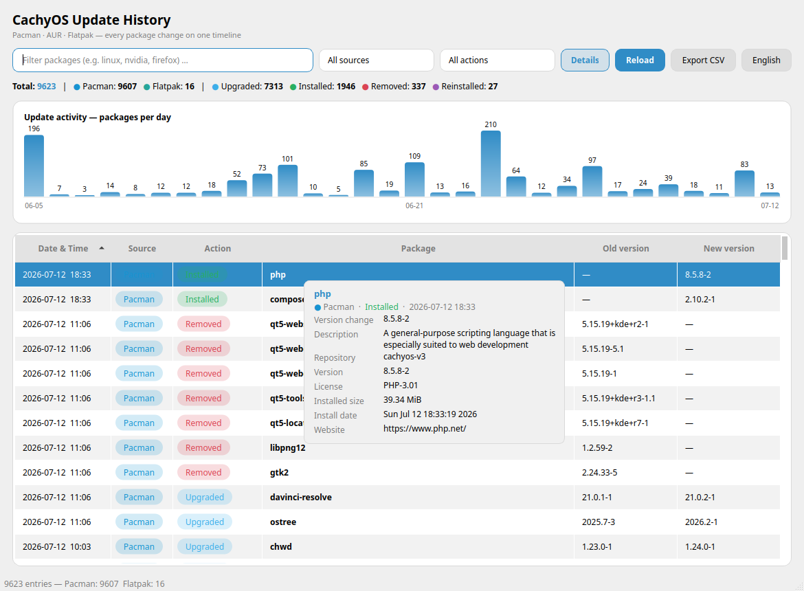
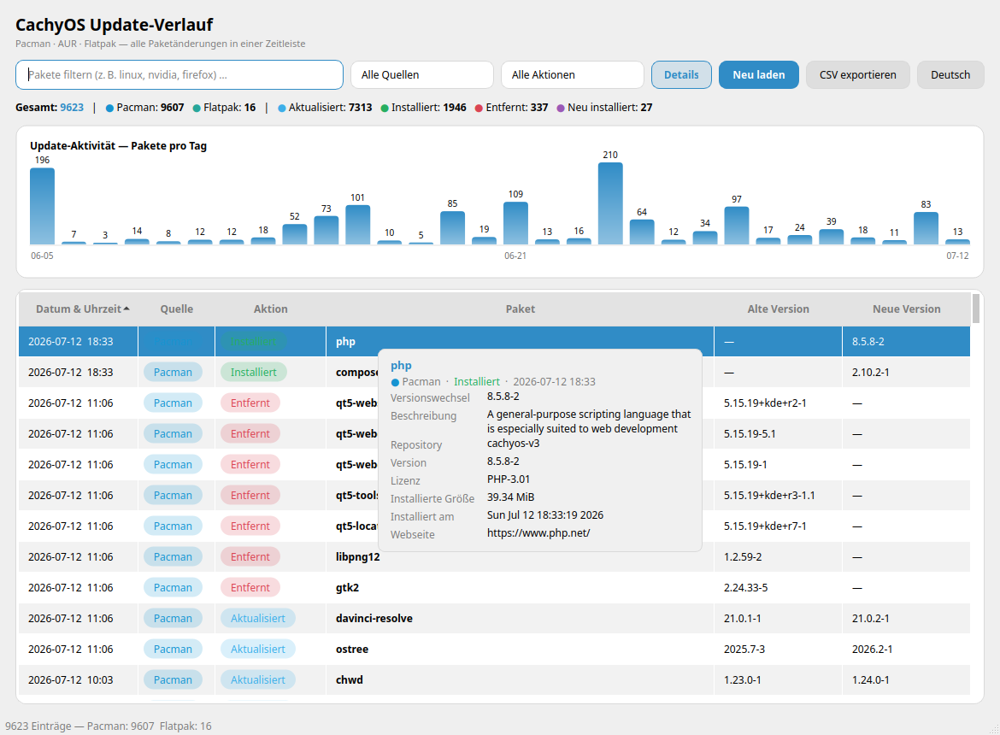

# CachyOS Update History

A small, dependency-light PyQt6 desktop app that combines package changes from
Pacman, the AUR and Flatpak in one sortable timeline.

Built for [CachyOS](https://cachyos.org/) and other Arch-based distributions.
On systems without Pacman or Flatpak, unavailable sources are skipped without
preventing the rest of the app from loading.


[](https://github.com/fenvarien/cachy-update-history/releases/latest)



*English interface with on-demand package details.*



*German interface; language and tooltip preferences persist across restarts.*

## Highlights

- Pacman, AUR and Flatpak changes in one model/view-based table.
- Multi-token search matching packages, versions, dates, sources and actions in any order.
- Interactive per-day activity chart; click any bar to filter the view by that day.
- On-demand package details via hover tooltips or full dialog with clickable website links.
- Context menu and keyboard shortcuts (Ctrl+F, Ctrl+C, F5, Ctrl+S, Escape).
- High-performance streamed log parsing with C-level ISO-8601 parsing and ALPM pre-filtering.
- Dynamic system palette and dark/light mode integration without application restart.
- CSV export of the current filtered and sorted view.
- English and German UI with native light/dark palette integration.
- No root privileges, network service or background daemon required.

## Quick start

Requirements:

- Python 3.10 or newer;
- PyQt6;
- optionally the `pacman` executable for AUR classification/live details and
  `flatpak` for the Flatpak source.

On CachyOS or Arch Linux:

```text
sudo pacman -S python-pyqt6
git clone https://github.com/fenvarien/cachy-update-history.git
cd cachy-update-history
python3 cachy-update-history.py
```

With a virtual environment on another distribution:

```text
git clone https://github.com/fenvarien/cachy-update-history.git
cd cachy-update-history
python3 -m venv .venv
.venv/bin/python -m pip install -r requirements.txt
.venv/bin/python cachy-update-history.py
```

The virtual-environment commands do not require shell activation and therefore
work unchanged in fish, Bash and Zsh.

## Data sources

| Source | Data and classification |
| --- | --- |
| Pacman | Matching `[ALPM]` entries streamed from `/var/log/pacman.log`. |
| AUR | Pacman-log packages currently reported as foreign by `pacman -Qmq`. |
| Flatpak | System and user history for currently installed apps, plus one fallback entry when an app has no history. |

AUR classification is necessarily a current-state heuristic: the Pacman log
does not record the original repository. Removed AUR packages and packages that
later moved into an official repository can therefore appear as Pacman.

For exact field semantics, fallback behavior and known limitations, see the
[User guide](docs/USER_GUIDE.md).

## Documentation

| Document | Purpose |
| --- | --- |
| [User guide](docs/USER_GUIDE.md) | Installation, operation, configuration, data semantics and troubleshooting. |
| [Architecture](docs/ARCHITECTURE.md) | Data flow, threading, normalized records, security boundaries and extension points. |
| [Changelog](CHANGELOG.md) | Released versions and changes currently on `master`. |
| [Contributing](CONTRIBUTING.md) | Development setup, required checks and documentation maintenance rules. |
| [Security policy](SECURITY.md) | Supported versions, threat model and vulnerability reporting. |

## Security and performance

The app treats logs and package-tool output as untrusted input. External tools
are invoked without a shell, package arguments are separated from options,
Flatpak IDs are validated before filesystem use, rich text is escaped and CSV
formula prefixes are neutralized. Preferences use bounded parsing and private,
atomic writes.

Potentially slow log and subprocess work runs in a bounded Qt worker pool.
Search strings are normalized once per record, and both tooltip cache and queue
have fixed limits. See [Security policy](SECURITY.md) and
[Architecture](docs/ARCHITECTURE.md) for the maintained guarantees and residual
risks.

## Project status

The latest stable version is published on the
[GitHub Releases page](https://github.com/fenvarien/cachy-update-history/releases/latest).
Changes merged after that release are documented under
[`Unreleased`](CHANGELOG.md#unreleased).

The application remains intentionally small: PyQt6 is its only required runtime
dependency, and the test suite uses Python's standard library.

## Contributing

Issues and pull requests are welcome. Before changing a data source, threading,
security behavior or user-facing workflow, read [CONTRIBUTING.md](CONTRIBUTING.md)
and [docs/ARCHITECTURE.md](docs/ARCHITECTURE.md).

Run the regression suite with:

```text
python3 -m unittest discover -s tests -v
```

## License

Released under the [GNU General Public License v3.0](LICENSE).
