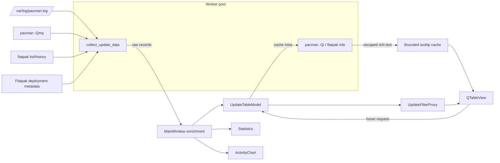

# Architecture

This document describes the current `master` implementation and the constraints
future changes should preserve. The application intentionally remains a single
runtime file; documentation and tests are separate.

## Goals and non-goals

### Goals

- Present local package history without root privileges.
- Keep optional package managers optional.
- Remain responsive when logs or external commands are slow.
- Treat log and command output as untrusted input.
- Use the Qt model/view architecture for histories with many rows.
- Avoid runtime dependencies beyond PyQt6.

### Non-goals

- Reconstruct historically exact AUR repository membership.
- Maintain a background database or daemon.
- Modify, install, remove or update packages.
- Contact remote package services.
- Provide a stable Python API for importing the script as a library.

## System overview

All Qt widgets and model mutations stay in the GUI thread. Filesystem reads,
package-manager commands and tooltip metadata queries run in `QThreadPool`
workers.

## Runtime components

| Component | Responsibility |
| --- | --- |
| `_load_config`, `_save_config` | Bounded JSON preferences and private atomic persistence. |
| `get_foreign_packages` | Current foreign-package set from `pacman -Qmq`. |
| `read_flatpak_*` | Installed apps, history and deployment timestamp fallback. |
| `collect_update_data` | Raw Pacman/AUR/Flatpak collection without touching Qt widgets. |
| `_LoadWorker` | Execute a complete collection outside the GUI thread. |
| `_TooltipWorker` | Query one package's current metadata outside the GUI thread. |
| `_DetailsWorker` | Query the detail rows for `PackageDetailsDialog` outside the GUI thread. |
| `UpdateTableModel` | Store normalized rows and provide display, sort, color and tooltip roles. |
| `UpdateFilterProxy` | Apply text/source/action filters and sorting. |
| `BadgeDelegate` | Paint source and action badges without per-cell widgets. |
| `PackageDetailsDialog` | Detailed package view with clickable URLs and clipboard export. |
| `ActivityChart` | Draw, hit-test and interactive filtering for the per-day chart with `QPainter`. |
| `MainWindow` | Own UI state, workers, translation, enrichment, aggregates and export. |

## Data collection and normalization

### Raw record

Collectors return dictionaries with these fields:

| Field | Type | Meaning |
| --- | --- | --- |
| `dt` | `datetime` or `None` | Parsed event/deployment time. |
| `action_key` | string | Key from `ACTIONS`. |
| `pkg` | string | Pacman package name or Flatpak application ID. |
| `old` | string | Old version or em dash. |
| `new` | string | New/current version or em dash. |
| `source_key` | string | Key from `SOURCES`. |

`collect_update_data` also returns source availability and a structured Pacman
log error. Missing Pacman data does not discard Flatpak rows.

### GUI-thread enrichment

`MainWindow._load_completed` adds fields used by views:

| Field | Purpose |
| --- | --- |
| `sort_ts` | Numeric chronological key; unknown dates sort as zero. |
| `display` | Local date/time display or em dash. |
| `action_label`, `source_label` | Current-language labels. |
| `action_color`, `source_color` | Badge colors. |
| `search_text` | Precomputed case-folded package/source/action text. |

Language switching updates translated fields and rebuilds `search_text`, then
resets the model. Raw data is not re-read.

## Filtering and aggregation

The proxy filters lazily for table display. `MainWindow.apply_filters` also
performs one explicit pass over `all_data` so the status line, statistics and
chart receive the same record selection. Statistics and day buckets are then
computed from that selection.

On Qt 6.10 and newer, custom filter changes use `beginFilterChange()` and
`endFilterChange(Direction.Rows)`. Older supported Qt versions retain the
`invalidateFilter()` fallback; PyQt6 6.5 remains the minimum. This avoids the
API scheduled for deprecation in Qt 6.13 without dropping older Qt runtimes.

Important performance invariants:

- never create a widget per table cell;
- never resize columns by scanning all row contents after a reload;
- debounce free-text aggregate updates;
- normalize case-folded search text once per record/language;
- stream the Pacman log rather than reading it as one string.

The complete normalized history is retained in memory. Introducing a record
limit, pagination or persistent index would change product semantics and should
be treated as an explicit architectural decision.

## Concurrency model

One `QThreadPool` owned by `MainWindow` has at most three active threads:

- one high-priority full-data load can be active;
- tooltip tasks share the remaining capacity;
- one high-priority package-details query (for the dialog) can be active; the
  dialog opens only when its result arrives;
- the reload button and `_load_worker` guard prevent overlapping full loads;
- at most 12 tooltip requests can be queued/running;
- completed tooltip HTML is stored in a 256-entry LRU cache.

Workers emit Qt signals carrying Python data. Slots on `MainWindow` enrich data,
mutate models, update widgets and show tooltips in the GUI thread. Workers must
not access Qt widgets or change global language state.

Tooltip keys contain source, package and language. A language change can safely
leave an old-language worker running because its result cannot match the current
hover key.

## Security boundaries

The application runs with the invoking user's privileges and does not need
root. Trust boundaries are:

1. Pacman log content;
2. `pacman` and `flatpak` stdout;
3. Flatpak deployment filesystem metadata;
4. the local JSON preference file;
5. user-selected CSV destinations.

Maintained controls:

- commands are resolved to absolute paths and run as argument lists with no
  shell;
- user-controlled package values follow `--` where the command accepts package
  arguments;
- all subprocesses have timeouts and stable parsing locale where required;
- Flatpak IDs exclude separators and glob metacharacters before path use;
- dynamic rich-text values are HTML-escaped;
- CSV formula/control prefixes are neutralized;
- config input is bounded and type-checked;
- config output uses a random mode-`0600` temp file, `fsync` and atomic replace;
- cache, pending tooltip requests and configuration size have fixed limits.

Residual risks and reporting instructions belong in [SECURITY.md](../SECURITY.md),
not duplicated ad hoc in implementation comments.

## Adding or changing a data source

Prefer existing normalization and worker boundaries:

1. Implement pure collection/parsing helpers that do not touch Qt widgets.
2. Use argument-list subprocess calls, explicit timeouts and stable output
   formats/locales.
3. Validate identifiers before filesystem or rich-text use.
4. Return the raw record schema documented above.
5. Add the source key/color and both English and German labels.
6. Integrate collection into `collect_update_data` so it stays off the GUI
   thread.
7. Add parser, failure-path, injection and normalization regression tests.
8. Update the user guide, this architecture document and `Unreleased` changelog.

Adding an external dependency needs a concrete benefit over standard-library or
Qt functionality and must be documented in `requirements.txt`, README and the
contributor setup.

## Changing the UI or translations

Every translation key must exist in both `_T["en"]` and `_T["de"]`. User-facing
filter labels participate in `search_text`, so language changes must continue to
retranslate rows before filtering.

Custom drawing must derive colors from `QPalette`; hard-coded fallback colors
may exist only where no palette role is available. Keep view rendering lazy and
avoid per-row widgets.

When screenshots materially change, replace both language variants together and
record the update in `CHANGELOG.md`.

## Architectural limitations

- The single runtime file is easy to distribute but increasingly expensive to
  navigate. Split it only when a change produces a clear module boundary and a
  migration can preserve direct-script execution.
- `subprocess.run(..., capture_output=True)` bounds execution time but not output
  size. A streaming/capped reader is the next step if real Flatpak histories
  become large enough to cause memory pressure.
- Aggregate refresh is linear in the retained history. Current debouncing keeps
  this practical; very large logs may eventually require incremental indexes.
